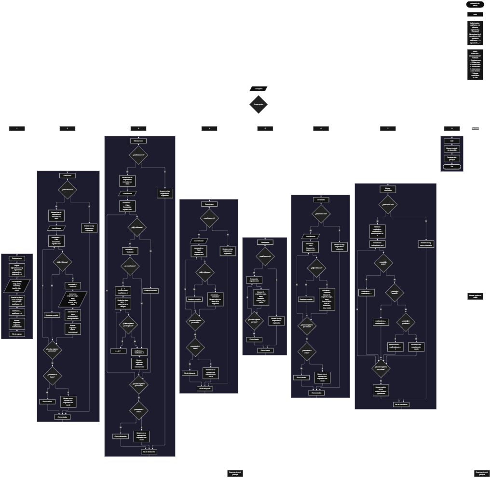

 

Este proyecto, llamado <b>asignación de turnos</b>, fue desarrollado en <b>pseint</b> como un ejercicio práctico para fortalecer la lógica de programación mediante la creación de un sistema de gestión de turnos de empleados desde la consola. El programa cuenta con un menú principal de ocho opciones que permite <b>registrar, editar, eliminar, buscar, listar y consultar los detalles</b> de las asignaciones, además de mostrar estadísticas generales y finalizar la ejecución. Cada asignación almacena información como el identificador, el nombre del empleado, el cargo, el turno, la hora de inicio, la hora de finalización, el día y el estado. Para organizar los registros, se utilizan ocho arreglos paralelos de 100 posiciones y una variable que controla la cantidad de asignaciones registradas. Durante su desarrollo se aplicaron conceptos fundamentales de programación, como variables, arreglos, estructuras condicionales, ciclos repetitivos, estructuras de selección y procedimientos para buscar, modificar, eliminar y organizar registros. Este proyecto permite poner en práctica los conocimientos adquiridos en PSeInt y sirve como base para desarrollar sistemas de gestión más avanzados utilizando otros lenguajes y tecnologías.

<h2 align="center">⚙️ Funcionamiento del menú principal</h2>

### ➕ Registrar turno

La opción <b>1) registrar turno</b> permite registrar una nueva asignación de turno para un empleado. Primero, el programa utiliza la variable <b>siguienteID</b> para asignar un identificador consecutivo a la nueva asignación. Después, incrementa esta variable y solicita los datos del empleado: <b>nombre, cargo, turno, hora de inicio, hora de finalización, día y estado</b>. Cada dato se almacena en la posición <b>totalTurnos + 1</b> de su respectivo arreglo. Finalmente, incrementa la variable <b>totalTurnos</b> y muestra el mensaje <b>"asignacion registrada correctamente."</b>. Aunque los arreglos están dimensionados con 100 posiciones, el código actual no comprueba si se ha alcanzado esa capacidad antes de registrar una nueva asignación. Por ello, no existe una validación explícita que impida superar el límite declarado.

### ✏️ Editar turno

La opción <b>2) editar turno</b> permite modificar los datos de una asignación registrada. Primero, el programa comprueba si la variable <b>totalTurnos</b> es igual a cero. Si no existen asignaciones, muestra el mensaje <b>"no hay asignaciones registradas."</b>. En caso contrario, presenta una lista con el identificador, empleado, cargo, turno, hora de inicio, hora de finalización, día y estado de cada registro. Después, solicita el identificador de la asignación que se desea editar y establece la variable lógica <b>encontrado</b> en <b>falso</b>. Mediante un ciclo <b>para</b>, recorre los identificadores almacenados y los compara con el valor introducido utilizando la condición <b>id[i] = idBuscar</b>. Cuando encuentra una coincidencia, cambia <b>encontrado</b> a <b>verdadero</b> y solicita los nuevos datos del empleado, cargo, turno, hora de inicio, hora de finalización, día y estado, actualizando directamente los arreglos correspondientes. Finalmente, muestra el mensaje <b>"asignacion editada correctamente."</b>. Si no encuentra el identificador, presenta el mensaje <b>"no se encontro una asignacion con ese id."</b>. El código no valida que los nuevos valores pertenezcan a una lista específica de turnos o estados.

### 🗑️ Eliminar turno

La opción <b>3) eliminar turno</b> permite eliminar una asignación mediante su identificador. Antes de comenzar, el programa comprueba si existen registros almacenados. Si no hay asignaciones, muestra el mensaje <b>"no hay asignaciones registradas."</b>. Si existen registros, presenta una lista con los datos de cada asignación y solicita el identificador que se desea eliminar. Después, inicializa la variable <b>encontrado</b> en <b>falso</b> y recorre los identificadores mediante un ciclo <b>para</b>. Cuando encuentra una coincidencia, cambia la variable a <b>verdadero</b>. Si la posición seleccionada es anterior a la última posición ocupada, utiliza otro ciclo <b>para</b>, controlado por la variable <b>j</b>, para desplazar una posición hacia atrás los datos de los arreglos <b>id, empleado, cargo, turno, horaInicio, horaFin, dia y estado</b>. Posteriormente, disminuye <b>totalTurnos</b> en uno y muestra el mensaje <b>"asignacion eliminada correctamente."</b>. Si no encuentra el identificador, muestra el mensaje <b>"no se encontro una asignacion con ese id."</b>. La eliminación se realiza directamente, sin solicitar una confirmación previa. El código tampoco limpia explícitamente los valores de la última posición después de disminuir el contador.

### 🔎 Buscar turno

La opción <b>4) buscar turno</b> permite localizar una asignación mediante su identificador. Primero, el programa comprueba si existen registros. Si no hay asignaciones, muestra el mensaje <b>"no hay asignaciones registradas."</b>. En caso contrario, solicita el identificador de la asignación y establece la variable lógica <b>encontrado</b> en <b>falso</b>. A continuación, utiliza un ciclo <b>para</b> para recorrer los identificadores almacenados y comprobar la condición <b>id[i] = idBuscar</b>. Cuando encuentra una coincidencia, cambia la variable a <b>verdadero</b>, muestra el mensaje <b>"datos encontrados"</b> y presenta el identificador, el empleado, el cargo, el turno, la hora de inicio, la hora de finalización, el día y el estado. Si finaliza el recorrido sin encontrar coincidencias, muestra el mensaje <b>"no se encontro una asignacion con ese id."</b>. Esta operación permite consultar una asignación sin modificar sus datos.

### 📋 Listar turnos

La opción <b>5) listar turnos</b> permite visualizar todas las asignaciones registradas. Antes de mostrar la información, el programa comprueba si <b>totalTurnos</b> es igual a cero. Si no existen registros, muestra el mensaje <b>"no hay asignaciones registradas."</b>. Si hay asignaciones disponibles, presenta el mensaje <b>"datos registrados"</b> y utiliza un ciclo <b>para</b> para recorrer los arreglos desde la primera posición hasta el total de registros. En cada repetición, muestra el identificador, el empleado, el cargo, el turno, la hora de inicio, la hora de finalización, el día y el estado. De esta manera, el usuario puede consultar las asignaciones existentes sin tener que buscar cada una por separado.

### 📄 Ver detalles de la asignación

La opción <b>6) ver detalles</b> permite consultar individualmente toda la información de una asignación. Primero, el programa verifica si existen registros. Si no hay asignaciones, muestra el mensaje <b>"no hay asignaciones registradas."</b>. En caso contrario, solicita el identificador de la asignación que se desea consultar e inicializa la variable <b>encontrado</b> en <b>falso</b>. Después, recorre los identificadores mediante un ciclo <b>para</b> y compara cada valor con el identificador introducido. Si encuentra una coincidencia, cambia la variable a <b>verdadero</b> y muestra el encabezado <b>"detalles de la asignacion"</b>, seguido del identificador, empleado, cargo, turno, hora de inicio, hora de finalización, día y estado, cada uno en una línea independiente. Si no encuentra el identificador, muestra el mensaje <b>"no se encontro una asignacion con ese id."</b>. Esta opción facilita consultar de manera organizada todos los datos de un turno específico.

### 📊 Mostrar estadísticas

La opción <b>7) mostrar estadísticas</b> permite obtener un resumen de las asignaciones según su estado. Primero, el programa comprueba si la variable <b>totalTurnos</b> es igual a cero. Si no existen registros, muestra el mensaje <b>"no hay turnos registrados."</b>. En caso contrario, inicializa los contadores <b>totalActivos, totalInactivos y totalPendientes</b> en cero. Después, utiliza un ciclo <b>para</b> para recorrer todas las asignaciones registradas y compara el valor de <b>estado[i]</b> con las cadenas <b>"activo", "inactivo" y "pendiente"</b>. Cuando encuentra una coincidencia, incrementa el contador correspondiente. Finalmente, presenta el encabezado <b>"estadistica general"</b> y muestra el total de turnos, los turnos activos, los turnos inactivos y los turnos pendientes. Los contadores se calculan en cada ejecución de esta opción, por lo que las estadísticas reflejan los estados almacenados en ese momento. La clasificación utiliza coincidencias exactas y no incluye otros estados en los contadores específicos.

### 🚪 Salir del menú principal

La opción <b>8) salir</b> permite finalizar el uso del programa. Cuando el usuario selecciona esta opción, el sistema muestra el mensaje <b>"gracias por utilizar asignacion de turnos."</b>. El menú principal se encuentra dentro de una estructura repetitiva <b>repetir ... hasta que</b>, cuya condición final es <b>hasta que opcion = 8</b>. Por tanto, al seleccionar la opción 8, el ciclo termina y la ejecución del algoritmo finaliza correctamente. Si el usuario introduce un número que no corresponde a ninguna opción del menú, la estructura <b>segun</b> ejecuta el bloque <b>de otro modo</b> y muestra el mensaje <b>"opcion no valida."</b>.

<h2 align="center">🧠 Temas aplicados en el proyecto</h2>

### 📦 Variables

En este proyecto se utilizan variables para controlar el menú, contar las asignaciones registradas, generar identificadores, recorrer los arreglos, localizar registros y determinar si se encontró una asignación. También se utilizan contadores para calcular las estadísticas según el estado de cada turno. Cada variable cumple una función dentro de las operaciones de administración de las asignaciones.

🔢 **Opcion:** Almacena la opción seleccionada por el usuario en el menú principal.

📊 **TotalTurnos:** Almacena la cantidad actual de asignaciones registradas.

🔄 **I:** Funciona como contador en los ciclos `para` y permite recorrer las posiciones de los arreglos.

🔁 **J:** Controla el recorrido utilizado para desplazar los datos de los registros posteriores durante la eliminación.

🔎 **IdBuscar:** Almacena el identificador introducido por el usuario para localizar una asignación.

🆔 **SiguienteID:** Genera identificadores consecutivos para las nuevas asignaciones registradas.

✅ **Encontrado:** Variable lógica que indica si se encontró una asignación con el identificador solicitado.

📈 **TotalActivos:** Cuenta las asignaciones cuyo estado coincide exactamente con `"activo"`.

📉 **TotalInactivos:** Cuenta las asignaciones cuyo estado coincide exactamente con `"inactivo"`.

⏳ **TotalPendientes:** Cuenta las asignaciones cuyo estado coincide exactamente con `"pendiente"`.

Las variables <b>totalActivos, totalInactivos y totalPendientes</b> se inicializan y utilizan en la opción de estadísticas, aunque no aparecen declaradas explícitamente mediante la instrucción <b>definir</b> en el código compartido.

### 🗃️ Arreglos

En este proyecto se utilizan ocho arreglos paralelos, cada uno dimensionado con <b>100 posiciones</b>. Todos los arreglos utilizan el mismo índice para representar los datos de una misma asignación. Por ejemplo, la información almacenada en la posición <b>1</b> de cada arreglo corresponde al mismo turno, incluyendo su identificador, empleado, cargo, horario, día y estado. Esta organización permite recorrer, buscar, modificar, mostrar y eliminar los registros de manera coordinada.

🆔 **Id[100]:** Almacena los identificadores de las asignaciones registradas.

👤 **Empleado[100]:** Almacena los nombres de los empleados.

💼 **Cargo[100]:** Almacena los cargos correspondientes a cada empleado.

🕒 **Turno[100]:** Almacena el turno asignado al empleado.

🕘 **HoraInicio[100]:** Almacena la hora de inicio de cada asignación.

🕔 **HoraFin[100]:** Almacena la hora de finalización de cada asignación.

📅 **Dia[100]:** Almacena el día asignado para el turno.

📌 **Estado[100]:** Almacena el estado de cada asignación.

### 🔀 Estructuras condicionales

En este proyecto se utilizan las estructuras <b>si</b> y <b>sino</b> para comprobar si existen asignaciones registradas antes de ejecutar determinadas operaciones, comparar los identificadores introducidos con los almacenados, determinar si se encontró un registro y clasificar las asignaciones según su estado. También se utilizan condiciones para decidir si es necesario desplazar los datos durante la eliminación, mediante la comparación entre <b>i</b> y <b>totalTurnos</b>. Estas estructuras permiten ejecutar diferentes instrucciones según el resultado de cada comprobación.

### 🔄 Estructuras repetitivas

El programa utiliza las estructuras repetitivas <b>para</b> y <b>repetir ... hasta que</b>. Los ciclos <b>para</b> permiten recorrer los arreglos durante las operaciones de edición, eliminación, búsqueda, listado, consulta de detalles y cálculo de estadísticas. En la eliminación, un ciclo adicional desplaza los datos de las posiciones posteriores para mantener organizados los registros. Por otro lado, el ciclo <b>repetir ... hasta que</b> mantiene activo el menú principal hasta que el usuario selecciona la opción <b>8</b>. De esta manera, el programa puede ejecutar diferentes operaciones durante una misma sesión.

### 🎯 Estructura según

La estructura <b>segun</b> evalúa el valor almacenado en la variable <b>opcion</b> y ejecuta el bloque de instrucciones correspondiente. Cada caso representa una operación del sistema: registrar, editar, eliminar, buscar, listar, ver detalles, mostrar estadísticas o salir. Además, el bloque <b>de otro modo</b> muestra el mensaje <b>"opcion no valida."</b> cuando el valor introducido no coincide con ninguna de las ocho opciones definidas en el menú.

### 🔢 Dimensionamiento de arreglos

La instrucción <b>dimension</b> establece la capacidad de los ocho arreglos utilizados para almacenar los datos de las asignaciones. Cada uno dispone de <b>100 posiciones</b>. La variable <b>totalTurnos</b> controla cuántos registros se consideran activos durante la ejecución, mientras que <b>siguienteID</b> genera los identificadores de las nuevas asignaciones. Sin embargo, el programa no comprueba explícitamente si existe espacio disponible antes de registrar otro turno, por lo que la capacidad declarada no está protegida mediante una validación.

### 🔄 Reorganización de registros

Cuando se elimina una asignación, el programa comprueba si su posición es anterior a la última posición ocupada mediante la condición <b>i &lt; totalTurnos</b>. Si se cumple, utiliza el ciclo <b>para</b> controlado por <b>j</b> para copiar los valores de la posición siguiente sobre la posición actual en los ocho arreglos. Después, disminuye <b>totalTurnos</b> en uno. Este procedimiento permite mantener consecutivas las posiciones utilizadas por los registros restantes. La variable <b>siguienteID</b> no se modifica durante la eliminación, por lo que conserva la secuencia de identificadores generados.

<h2 align="center">¿Cómo se implementaron las operaciones crud en el proyecto?</h2>

Las operaciones <b>crud</b> se implementaron mediante las opciones del menú principal para administrar las asignaciones de turnos. La operación <b>crear</b> corresponde a <b>registrar turno</b>, donde se introducen los datos de un nuevo registro. La operación <b>leer</b> se realiza mediante las opciones <b>buscar turno, listar turnos y ver detalles</b>, que permiten consultar la información almacenada. La operación <b>actualizar</b> corresponde a <b>editar turno</b>, donde se modifican los datos de una asignación existente. Por último, la operación <b>eliminar</b> se realiza mediante la opción <b>eliminar turno</b>, que desplaza los datos posteriores y reduce el contador de registros. Estas operaciones utilizan variables, arreglos, condicionales y ciclos para administrar la información durante la ejecución del programa.

<h2 align="center">Diagrama de flujo del proyecto</h2>

<h2 align="center">🛡️ Validaciones del programa</h2>

### 📭 No existen asignaciones registradas

Esta comprobación se utiliza en las operaciones de <b>editar, eliminar, buscar, listar, ver detalles y mostrar estadísticas</b>. El programa verifica si la variable <b>totalTurnos</b> es igual a <b>0</b>. Si no existen registros, muestra el mensaje correspondiente e impide continuar con la operación que necesita datos almacenados. Esta comprobación evita realizar búsquedas, modificaciones o consultas sobre una lista vacía.

### 🔎 Identificador no encontrado

Esta comprobación se utiliza durante las operaciones de <b>editar, eliminar, buscar y ver detalles</b>. Antes de recorrer los arreglos, el programa inicializa la variable lógica <b>encontrado</b> en <b>falso</b>. Si encuentra una coincidencia entre <b>id[i]</b> e <b>idBuscar</b>, cambia su valor a <b>verdadero</b> y ejecuta las instrucciones correspondientes. Si termina el recorrido y la variable continúa siendo <b>falso</b>, muestra el mensaje <b>"no se encontro una asignacion con ese id."</b>.

### 📊 Clasificación de los estados

En la opción de estadísticas, el programa compara el contenido del arreglo <b>estado</b> con los valores <b>"activo", "inactivo" y "pendiente"</b>. Cada coincidencia incrementa el contador correspondiente. Sin embargo, no existe una validación que obligue al usuario a introducir únicamente estos estados durante el registro o la edición. Por ello, otros valores pueden almacenarse, pero no se contabilizan en ninguna de las tres categorías de las estadísticas.

### ⚠️ Capacidad de los arreglos

Los ocho arreglos están dimensionados con <b>100 posiciones</b>, pero la opción de registro no incluye una condición que compruebe si <b>totalTurnos &lt; 100</b> antes de almacenar una nueva asignación. Por este motivo, el código actual no impide explícitamente registrar más elementos de los que permite la capacidad declarada. Esta limitación debe tenerse en cuenta al documentar el funcionamiento real del programa.

### 🔢 Identificadores consecutivos

La variable <b>siguienteID</b> se inicializa en <b>1</b> y se incrementa cada vez que se registra una asignación. De esta manera, los nuevos registros reciben identificadores consecutivos. Cuando se elimina una asignación, el programa desplaza los datos de los arreglos, pero no reinicia ni disminuye <b>siguienteID</b>. Así, los identificadores nuevos continúan la secuencia de generación durante la ejecución.

### ⚠️ Opción no válida

La estructura <b>segun</b> incluye el bloque <b>de otro modo</b>, que muestra el mensaje <b>"opcion no valida."</b> cuando el usuario introduce un número que no corresponde a ninguna opción definida. Esta respuesta permite informar al usuario de que debe seleccionar una de las opciones disponibles en el menú principal.

<h2 align="center">🎯 Objetivo del proyecto</h2>

El objetivo principal de este proyecto es fortalecer la <b>lógica de programación</b> mediante el desarrollo de un sistema de asignación de turnos en <b>pseint</b>. A través de su construcción se busca aplicar los conocimientos adquiridos sobre variables, arreglos, estructuras condicionales, ciclos repetitivos y estructuras de selección, integrándolos para resolver un problema de administración de registros. Además, el proyecto permite comprender cómo registrar, consultar, modificar y eliminar información, así como generar estadísticas a partir de los datos almacenados. De esta manera, constituye una base práctica para desarrollar sistemas de gestión más completos utilizando otros lenguajes y tecnologías.

